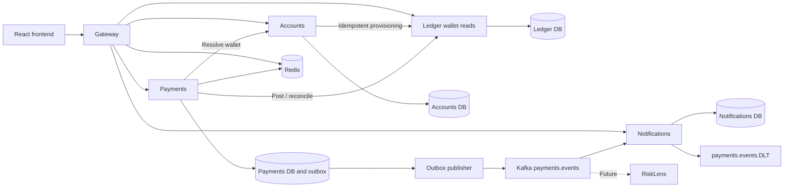
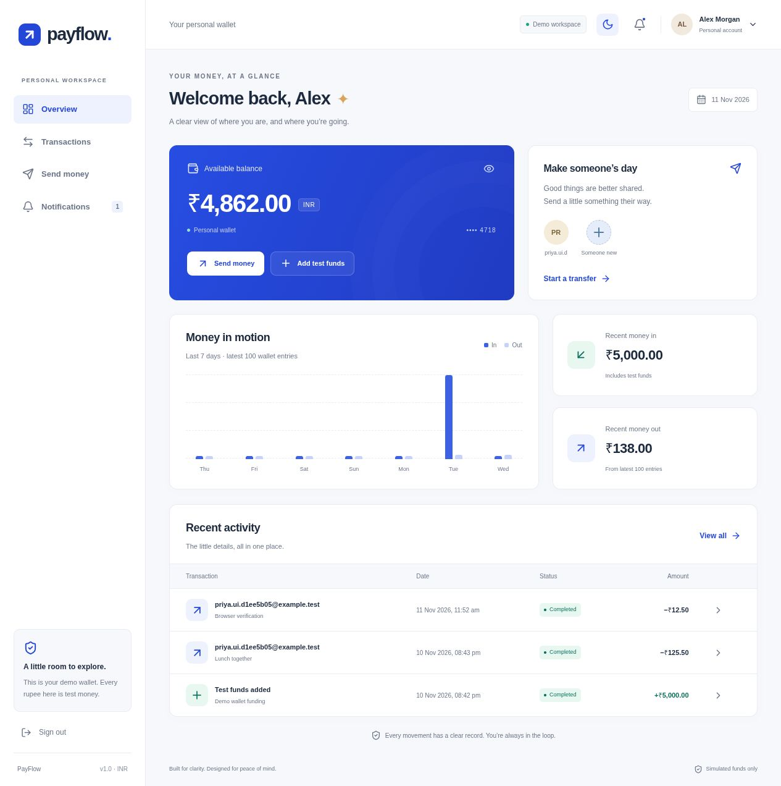

# PayFlow

PayFlow is a distributed wallet and payments portfolio project that makes the hard parts visible: exact money arithmetic, concurrent balance protection, safe retries after uncertain network outcomes, and reliable event delivery across services. Users register, add simulated INR, send money, and follow each payment through its timeline and notifications. A responsive React dashboard sits over five Java services; PostgreSQL is the financial source of truth, Redis accelerates idempotency and risk checks, and Kafka carries versioned payment events. **All funds are simulated.**

## Run in three commands

From this checkout, with **JDK 17, Node 20+, Git and Docker Desktop** available (Node 22 recommended):

```sh
node scripts/setup-env.mjs
docker compose -f infra/docker-compose.yml --profile all config --quiet
docker compose -f infra/docker-compose.yml --profile all up --build
```

Open [PayFlow](http://localhost:5173). Register two test users, add test funds, then send a payment to the other user's email. Use a test password. The setup script generates independent local secrets in the ignored `.env` and enables demo funding explicitly. Existing secrets are preserved.

PostgreSQL, Redis and Kafka run **only in Docker**. Compose stays in the foreground; stop with Ctrl+C, then `docker compose -f infra/docker-compose.yml down`. Named volumes preserve data. `down -v` destroys that data and is only for an intentional reset. No local database installation is needed.

## What it demonstrates

- Double-entry ledger with immutable journal entries, checked 64-bit minor units, ordered wallet locks and durable transfer uniqueness.
- Idempotent send-money and test-funding APIs: Redis response cache plus durable database reservation, request hash, original response and fixed 24-hour window.
- Timeout reconciliation using the same transfer ID; a timeout remains pending until the ledger supplies an authoritative outcome.
- Configurable velocity limits, auditable payment state transitions and transactional outbox publication.
- Kafka consumers with duplicate detection, three processing attempts and a dead-letter topic.
- BCrypt credentials, short-lived JWTs, per-user rate limits, service authentication, ownership checks and consistent traceable errors.
- Responsive light/dark UI with exact money formatting, review-before-send, recovery-safe retries, history filters, status timeline and notifications.
- Docker integration tests, k6 measurement, Prometheus metrics and GitHub Actions checks.

## Architecture



Each stateful service owns its database and role. Cross-service access uses REST or Kafka; applications never read another service's tables. The gateway has no business tables. [Architecture and failure sequence](docs/architecture.md) · [Tables and constraints](docs/data-model.md) · [REST and event contracts](docs/api.md).

| Area | Stack |
|---|---|
| Backend | Java 17, Spring Boot 3.5, Spring Cloud Gateway, Spring Security, Data JPA/JDBC, Flyway |
| Data and events | PostgreSQL 16, Redis 7, Kafka KRaft, Spring Kafka |
| Frontend | React 18, strict TypeScript, Vite, Tailwind, React Router, TanStack Query, React Hook Form, Zod |
| Quality and operations | JUnit 5, Mockito, AssertJ, Testcontainers, Vitest, React Testing Library, k6, Actuator/Micrometer, GitHub Actions |

## Organization

```text
common/                       Money, errors, security, DTOs and event contracts
services/gateway/             Routing, JWT validation, CORS and rate limits
services/accounts-service/    Authentication, profiles and wallet provisioning
services/ledger-service/      Financial accounts, journal and transfers
services/payments-service/    Idempotency, risk, processing, reconciliation and outbox
services/notification-service/ Event consumption and user inbox
frontend/src/api/              Typed client and server-state queries
frontend/src/app/              Router and application shell
frontend/src/components/       Reusable presentation components
frontend/src/features/         Auth, dashboard, payments and notifications
infra/                        Docker Compose and database initialization
load-tests/                   k6 workload and measured evidence
docs/                         Contracts, ADRs, review, screenshots and build plan
```

Java features separate `api`, `domain` and `infra`. Controllers map DTOs; business services own decisions. The ledger uses explicit SQL row locks and transactions so the lock order and journal writes are easy to inspect.

## Screenshots and screens

Actual browser captures from the running Docker application:



[Mobile dashboard](docs/screenshots/dashboard-mobile.jpg) · [Transfer confirmation](docs/screenshots/transfer-mobile.jpg) · [Dark dashboard](docs/screenshots/dashboard-dark.jpg)

Screens: Login, Register, Dashboard, Send Money (details/review/result), Transactions (filters/pagination), Transaction Detail (timeline), Notifications, and the Add Test Funds dialog. Mobile navigation was checked at 360 px. Balances and activity come from real demo records, not fixed UI fixtures.

## Verify locally

```sh
./mvnw clean verify
cd frontend
npm ci
npm run lint
npm test
npm run build
npm audit --audit-level=moderate
```

The final Java run passed **42 tests**, including real PostgreSQL/Redis/Kafka Testcontainers tests. Frontend lint/build and **21 tests** passed. No tests were skipped. [Exact verification evidence](docs/verification.md) · [Final review and fixes](docs/review.md).

With the stack running, `node scripts/smoke.mjs` runs the curl-based registration/login/funding/payment/history/replay/ownership/notification walkthrough, including 20 concurrent retries. It uses disposable test identities and redacts credentials from output. `node scripts/check-invariants.mjs` performs operator-only cross-database verification through Docker; application services retain database isolation.

For Docker Desktop on Linux, Testcontainers may need:

```sh
export DOCKER_HOST="$(docker context inspect --format '{{.Endpoints.docker.Host}}')"
export DOCKER_API_VERSION=1.44
```

Use a JDK 17 `JAVA_HOME`. The Maven wrapper supplies Maven. CI runs the Java suite, frontend checks/audit and documentation/Compose validation. The workflow is locally validated; a hosted GitHub run requires pushing this checkout to a repository.

## Measured performance

On this machine, the 45-second payment workload completed **933 new payments**, with **127.24 ms p95 payment latency** and **0% unexpected errors**. Total traffic including setup/teardown was **975 requests at 17.05 requests/second**. The duplicate scenario created exactly one payment and one ledger transfer. Post-load checks found balanced books, no negative user wallets, no cached-balance mismatch and no duplicate active idempotency scope.

These are local measurements with five virtual users and raised load-only traffic limits, not production capacity claims. [Workload, environment, raw results and reproduction](load-tests/RESULTS.md).

## Development and operations

Infrastructure only: `docker compose -f infra/docker-compose.yml --profile infra up`. Load `.env` into the IDE process and start services on ports 8081–8084 and the gateway on 8080. `cd frontend && npm install && npm run dev` starts Vite with its API proxy. Optional IDE overrides are documented in `.env.example`; shared generic `DB_URL`/`PORT` values must be set per process.

Swagger UI is available at `http://localhost:8080/swagger-ui.html` (gateway), :8081 (accounts), :8082 (ledger), :8083 (payments), and :8084 (notifications). `/actuator/health`, `/actuator/health/readiness` and `/actuator/prometheus` are local operational endpoints on each service. Authenticated gateway ping routes are `/api/gateway/ping`, `/api/accounts/ping`, `/api/ledger/ping`, `/api/payments/ping`, and `/api/notifications/ping`.

Micrometer records payment counts by terminal status, request latency, pending outbox rows, publication failures and reconciliation deferrals. JWTs live only in browser memory, so a reload requires signing in again. Pending transfer metadata survives in session storage and retries reuse its original key.

## Decisions you can explain in an interview

- [Minor-unit money](docs/decisions/001-minor-unit-money.md): integer arithmetic avoids rounding errors; JSON strings preserve precision in JavaScript.
- [Double-entry ledger](docs/decisions/002-double-entry-ledger.md): each movement has equal opposite entries, giving a checkable audit trail.
- [Ordered pessimistic locks](docs/decisions/003-ordered-pessimistic-locks.md): every transfer locks the lower wallet ID first, preventing circular waits between wallet locks.
- [Durable idempotency with Redis](docs/decisions/004-redis-idempotency.md): a cache loss cannot create a second payment.
- [Transactional outbox](docs/decisions/005-transactional-outbox.md): state and the promise to publish commit together; consumers tolerate repeated delivery.
- [Database per service](docs/decisions/006-database-per-service.md): ownership is explicit and changes cross documented contracts.

A ledger timeout means “the outcome is unknown.” Keeping the same transfer ID makes recovery safe. The invariant tests establish conservation of value for tested workloads and check every cached balance against the journal; they are strong regression evidence, not a mathematical proof of every possible execution.

[Build plan and approved scope](docs/plan.md). No blocking open questions remain. V1 excludes real payment rails, FX, refunds, refresh tokens, email/SMS delivery and the future RiskLens consumer. Local Compose uses a single broker and loopback operational ports; production deployment needs its own availability and secret-management design.
