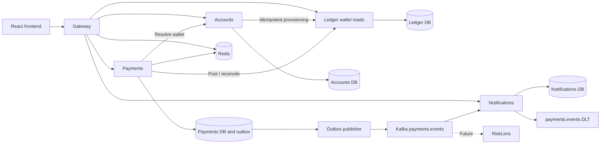
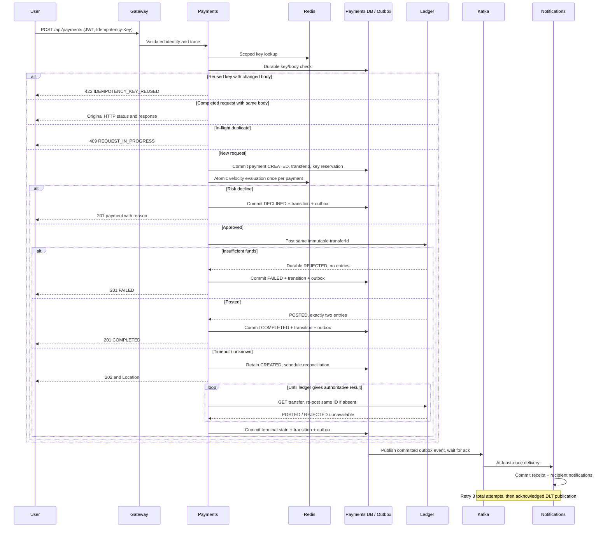

# PayFlow architecture

PayFlow is an INR-only simulated wallet platform. Java 17/Spring Boot 3.x services run behind Spring Cloud Gateway; React 18 is the browser client. PostgreSQL 16, Redis 7 and Kafka KRaft run only in Docker. Each stateful service owns its database and database role. Gateway has no business tables. Services never query another service's database.

## Ownership

| Component | Responsibilities | Owned data |
|---|---|---|
| Gateway | JWT validation, routing, CORS, per-user Redis rate limit, trace IDs | No business tables |
| Accounts | BCrypt credentials, registration/login, profiles, wallet provisioning/recovery | users, wallets |
| Ledger | Authoritative money balances, double-entry transfers, immutable transfer outcomes | ledger_accounts, transfers, ledger_entries |
| Payments | Idempotency, risk, state machine, test-funding orchestration, reconciliation, outbox | payments, payment_transitions, idempotency_records, risk_attempts, outbox_events |
| Notifications | At-least-once event processing, inbox, read state, retries/DLT | consumed_events, notifications |

## Send-money sequence

## Transaction and recovery boundaries

Registration commits a user and PROVISIONING wallet before an idempotent ledger PUT. Accounts retries provisioning until ACTIVE; duplicate registration returns 409 and login exposes provisioning state. Payment creation commits before network calls. A payment owns one transfer UUID forever. No distributed transaction is claimed.

Ledger uses a database transaction, transfer-ID serialization and ascending account-ID row locks. It checks currency, positive amount, available funds and checked integer arithmetic before inserting exactly one debit and credit and updating both cached balances. A declined transfer outcome is stored so its replay cannot later succeed. Deferred integrity checks validate the entry pair at commit. User wallets cannot be negative; the system funding account is the explicit exception. Entries are immutable.

Payments transition only CREATED -> COMPLETED/FAILED/DECLINED. Terminal transition and outbox insert commit together. A timeout leaves CREATED and reconciliation retries the same transfer ID. A missing GET result is not proof of failure. Worker claims use leases so a crashed worker cannot strand work permanently. Workers never overwrite a terminal outcome.

Idempotency scopes by user + operation + key, uses a canonical request hash and durable unique reservation, and expires 24 hours after first acceptance. Cache TTL does not slide. Original responses are immutable, including 202; GET gives current state. Key reuse after expiry creates a new operation. Transfer IDs never expire. Clients must track unresolved payment IDs and not initiate another transfer to replace them.

Risk counts unique attempts, never HTTP retries. Counters are atomic Redis Lua operations. Persistent risk_attempts provide conservative reconstruction after Redis loss. Admissions and reconstruction are serialized per user with a database advisory lock; unresolved recorded attempts count against limits. No refund of counters after ledger failure. Redis failure holds CREATED work for retry and rejects new work where needed; it never disables overdraft protection.

Outbox delivery is at least once: publish, await Kafka acknowledgment, then mark published. A crash between those steps duplicates an event. Notifications insert consumed_events and all notifications in one transaction; duplicates become no-ops. Source offsets advance only after database commit, or after acknowledged DLT publication. Three total attempts with 1s/5s backoff precede DLT. No email/SMS provider is part of V1.

## Security and operations

JWTs expire in 15 minutes, use an env-supplied signing secret and are revalidated by downstream services. Gateway removes spoofed identity headers. Internal endpoints require caller-specific env credentials and are never gateway routes. Only gateway/frontend bind public application ports; local service ports and infrastructure are loopback-only for IDE development. Public registration/login are rate limited by IP; protected APIs by user. CORS is an exact configured frontend origin.

Passwords use BCrypt. Token/password/recipient-note contents are never logged. JWT is kept in frontend memory, not localStorage. HTTPS termination and externally managed secrets are deployment concerns; local Compose is a demo. Funding is opt-in and never represents real bank money. Actuator exposes health and Prometheus metrics only on service/management access, not public gateway routes.

Money on REST/Kafka is a string; domain/database values are signed 64-bit integers. Frontend input/formatting uses BigInt/string arithmetic. Invariants are balanced entries per currency, cached balance equals entries, no negative user balances, and one transfer per accepted idempotent payment.

## Sources and interview explanation

- [PostgreSQL locking](https://www.postgresql.org/docs/16/explicit-locking.html): one lock order prevents cyclic wallet waits.
- [Redis scripting](https://redis.io/docs/latest/develop/programmability/eval-intro/): a script atomically evaluates and changes counters.
- [Spring Cloud compatibility](https://spring.io/projects/spring-cloud/): Boot 3.5 uses Cloud 2025.0.

A network timeout means “I don't know,” not “nothing happened.” Keeping the same transfer ID lets us safely ask again. The outbox solves a different problem: our state and our promise to publish change together, while consumers handle duplicate delivery.
